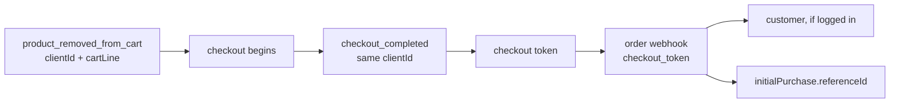

# Upsellora — Master App Blueprint (Revision 4, Stage 0)

| Field | Value |
|---|---|
| Document | Master product and architecture blueprint |
| Revision | 4 — tenant isolation, legacy compatibility, pixel scopes |
| Date | 2026-11-17 |
| Status | **Stage 1 not approved. Nothing implemented.** |
| Code, schema, migration, config, package, extension changes | **None** |
| Migrations generated or applied | None |
| Database changes | None |
| Files deleted | None |

Revision 4 is documentation-only. It preserves every Revision 3 decision and its
pending-approval status, and corrects five defects:

1. Stage 1A did not specify how `OfferExperience.shopId` is kept consistent with
   the owning rule, or what tests prove it.
2. Legacy update behavior did not distinguish an omitted `showOnCheckout` from an
   explicit one, did not define precedence, and did not require transactional
   synchronization.
3. Stage 1B did not state the cross-entity tenant invariants, the cross-rule
   parent rule, or exact `UNKNOWN` truth tables.
4. The pixel scope uncertainty was misstated: the scopes are documented
   requirements; the open question is approval and access.
5. The approval status language needed to remain strictly non-authorizing.

Evidence tags: `[C]` confirmed by Shopify documentation or this repository;
`[A]` assumption used only to design a test; `[U]` unverified, no shipped
behavior may depend on it.

---

## 1. Executive summary

Upsellora is a checkout-only upsell app with two experiences on one backend:

- **Pre-purchase** — checkout UI extension, Shopify Plus only.
- **Post-purchase** — post-purchase extension, Basic and above, only after
  Shopify grants post-purchase access, one post-purchase app per store.

The existing repository is a theme-based product/cart upsell app. Tenancy,
entitlements, the offer engine, catalog snapshots, analytics, attribution,
webhook idempotency, and privacy are reusable. The theme delivery layer is
frozen, not deleted.

The product must not show product/cart upsell UI, must not imply pre-purchase on
non-Plus stores, must not imply post-purchase access before approval, must not
count clicks or cart adds as revenue, must not call attributed revenue
incremental, and must not ship removed-product recommendations before the
identity association is proven.

---

## 2. Platform facts and configuration baseline

| # | Claim | Tag | Evidence |
|---|---|---|---|
| P1 | Pre-purchase checkout UI extensions are Plus-only | `[C]` | Shopify checkout requirements |
| P2 | Post-purchase is access-gated; one post-purchase app per store | `[C]` | Shopify post-purchase docs |
| P3 | At most three offers can be accepted on a post-purchase page | `[C]` | Shopify post-purchase docs |
| P4 | `product_removed_from_cart` carries `clientId`, `timestamp`, event `id`, `data.cartLine`; no cart token, checkout token, or customer | `[C]` | Web Pixel reference |
| P5 | `checkout_completed` carries `clientId` and a checkout object including a checkout token | `[C]` | Shape captured on a dev store |
| P6 | Web Pixels run sandboxed without DOM access | `[C]` | Pixel runtime constraints |
| P7 | Order webhooks include `checkout_token` | `[C]` | Order resource |
| P8 | `initialPurchase.referenceId` equals the order checkout token | `[U]` | U1 |
| P9 | Post-purchase changesets are app-secret JWTs applied with `applyChangeset` | `[C]` | Post-purchase API |
| P10 | Pre-purchase changes use `applyCartLinesChange`; Shopify recalculates totals | `[C]` | Checkout UI extension API |
| P11 | `write_app_proxy` is a valid access scope | `[C]` | Official access-scope reference |
| P12 | `write_pixels` and `read_customer_events` are documented requirements for Web Pixel registration and update | `[C]` | Scope and pixel references |
| P13 | Admin API `2026-10` is stable; `2027-01` is a release candidate | `[C]` | Version schedule, November 2026 |
| P14 | Guest association through `clientId` is reliable | `[U]` | Not assumed |

### Configuration baseline (read-only inspection)

| Setting | Location | Current | Assessment |
|---|---|---|---|
| Admin API version | `app/shopify.server.ts:15`, `:46` | `ApiVersion.October26` = `2026-10` | Correct stable version |
| Webhook version | `shopify.app.toml:18` | `2027-01` | Mismatch; recommend `2026-10` in Stage 2 |
| Runtime scopes | `app/shopify.server.ts:16` via `SCOPES` | env-driven | `.env.example:27` = `read_products,read_orders` |
| Config scopes | `shopify.app.toml:10` | `read_products,read_orders,write_app_proxy` | Drifts from runtime by `write_app_proxy` |
| App URL | `shopify.app.toml:5` | `shopify.dev/apps/default-app-home` | Template placeholder; production blocker |
| Redirect URL | `shopify.app.toml:65` | same placeholder | Production blocker |
| Pixel scopes | nowhere | absent | Required before pixel work; see D5 |
| Refund webhook | nowhere | absent | Required before refund attribution |

**Runtime versus deploy scopes.** `SCOPES` is requested during OAuth at runtime.
`[access_scopes]` is the deployed configuration. They must be identical. They
differ by `write_app_proxy`, which is valid, so the fix is alignment. Pixel
scopes are a separate later change and are not part of that alignment.

---

## 3. Final decision register

Status categories are mutually exclusive.

### Explicitly approved by the user

**None.** No decision in this document has been authorized by the user. The
"recommended" label describes a proposal, not permission.

### Recommended — awaiting explicit user approval (also pending approval)

| ID | Decision |
|---|---|
| D1 | Freeze product/cart placements; keep theme extension files; audit references before any deploy change; keep the theme extension distinct from a Web Pixel |
| D2 | Removed-product association stays experimental until the full matrix passes; no production condition or recommendation uses it |
| D3 | Post-purchase behind a disabled-by-default flag; dev-store validation first; request production access in parallel; independent from pre-purchase |
| D4 | Preserve handles `free`/`growth`/`pro`; keep numeric limits unchanged; pricing separate from schema |
| D5 | Align webhook version to `2026-10`; align scope lists in Stage 2; add pixel scopes only with the pixel implementation |
| D6 | `OfferExperience` join table; condition registry limited to verified data; defer collection conditions; defer behavior and checkout correlation tables |
| D7 | Split Stage 1 into 1A, 1B, 1C as separate migrations |
| D8 | Start with Stage 1A only after approval |

### Unresolved technical uncertainties

| ID | Uncertainty | Resolution | Blocks |
|---|---|---|---|
| U1 | `initialPurchase.referenceId` versus order checkout token | Log both on a dev store | Stage 4 only |
| U2 | Whether a pixel can read the cart cookie | Test `browser.cookie` | Stage 4 only |
| U3 | Whether `checkout_completed` always carries a customer identifier for logged-in buyers | Capture consented and non-consented payloads | Stage 4 only |
| U5 | Whether Shopify grants this app post-purchase production access | Open the request early | Post-purchase launch |
| U7 | Whether this app is granted approval for the protected pixel scope `read_customer_events`, and what the Partner Dashboard path is | Confirm approval state before requesting | Stage 4 |
| U8 | Whether the CLI bundles every directory under `extensions/` with no disable flag | Inspect CLI output | Stage 2 delivery only |

No Stage 1A item depends on any uncertainty.

---

## 4. D1 — Theme extension (recommended)

- Freeze product/cart placements; no new control may enable them.
- Keep `extensions/storefront-upsell/` in place. No deletion.
- Audit before any deploy-manifest change: extension assets, Liquid settings,
  proxy routes, analytics surfaces only the theme emits, cart webhook use,
  session-key generation, shared rate-limit buckets, theme-specific tests.
- The theme extension is not a Web Pixel. Different delivery, scopes, consent,
  review. It must not become the behavior tracker.
- Preserve proxy HMAC verification, cart diffing, snapshots, analytics ingestion,
  and rate limiting.
- Relocating the extension outside `extensions/` is a separately approved
  cleanup. U8 applies.

Current evidence: only one extension exists; no pixel extension;
`placements.server.ts` still marks product/cart implemented;
`app.analytics.tsx:76-79` still tells merchants to add a theme block;
`app.catalog.tsx` already redirects to the wizard. `[C]`

---

## 5. D2 — Removed product association (recommended)

### Existing reliable mechanism, separate from the pixel

`carts/update` webhooks are diffed against `CartWatch` into `CartActivity`
(`app/services/cart-activity.server.ts`), and `RECENTLY_REMOVED` is an existing
automatic source built from it. `[C]` This is cart-token-scoped and reliable
inside one cart's lifetime. It does not connect a removal to a person or to a
later order.

### Chain under test



| Link | Documented | Missing | Tag |
|---|---|---|---|
| Removal → clientId | Yes | Cart token, customer, order | `[C]` |
| clientId → checkout_completed | Both are pixel events | Same-browser delivery, consent, blockers, profiles | `[A]` |
| Completion → token | Checkout object has a token | Exact field path | `[C]` / capture shape |
| Token → order | Order has `checkout_token` | Equality with the pixel token | `[U]` |
| Order → customer | Logged-in orders only | Guest orders have none | `[C]` |
| Order → referenceId | `referenceId` supplied | Equality with the token | `[U]` |

### What can and cannot be associated

Can: cart token → cart contents; clientId → ordered pixel events from one browser
profile; checkout token → order; order → customer for logged-in orders.

Cannot: removal → customer; removal → cart token (unless U2 passes); clientId →
customer retroactively; `referenceId` → anything (U1); one person across
browsers/devices; a removal that never reaches checkout.

A customer account is not a bridge: the removal event carries no customer.

### Corrected multi-checkout rule (T4)

Sequence: removal R at `t_R`, checkout begins, checkout completes at `t_C`,
association attempted backwards.

- `W` = 120 minutes (constant, configurable, documented).
- `K` = the removal's `clientId`.
- `Completions(K, W, R)` = distinct checkout completions with the same `clientId`
  and different tokens, with `t_R < t_C ≤ t_R + W`.
- If a captured `checkout_started` precedes `t_R`, discard.

1. Associate R with C only if `Completions` contains exactly one completion, C.
   Zero → unassociated. More than one → ambiguous; discard every candidate.
2. Duplicate deliveries of one token count as one completion.
3. A removal associates with at most one order, enforced by a unique constraint
   on the association's removal id when that table exists.
4. One order may receive multiple removals.
5. Ambiguity is stored with a reason (`NO_COMPLETION`,
   `AMBIGUOUS_MULTIPLE_COMPLETIONS`, `STARTED_BEFORE_REMOVAL`), never guessed.
6. Two tabs sharing one `clientId` are indistinguishable; two completions in `W`
   are ambiguous by rule 1.

### Test matrix

| # | Scenario | Expected | Fail condition |
|---|---|---|---|
| T1 | Logged-in, remove then complete | One completion; order and customer resolve | Customer absent or token mismatch |
| T2 | Guest, same flow | Same association except no customer | Assumes a customer exists |
| T3 | Remove, never complete | No association; expires | Leaks into an unrelated order |
| T4 | Two checkouts in one browser | Associate only if exactly one completion follows in `W`; otherwise discard | Removal credited to two orders, or guessed |
| T5 | Two tabs | Dedupe; ambiguous checkouts discarded | Duplicate rows or reversed order |
| T6 | Pixel missing or blocked | No association; gap recorded | Phantom attribution |
| T7 | Consent denied | Event dropped before storage | Stored without consent basis |
| T8 | Out-of-order delivery | `occurredAt` respected with tolerance | Ordering by insertion time |
| T9 | Duplicate event id | One row | Double count |
| T10 | referenceId versus token | Equality proven or recorded as false | Code assumes equality early |
| T11 | Removal then two rapid checkouts | Discarded as ambiguous | One removal linked to both |

---

## 6. D3 — Post-purchase access (recommended)

| Dimension | Development store | Live store |
|---|---|---|
| Install | CLI dev install | Deployed version, merchant install |
| Payments | Test provider; wallets/installments unavailable | Real gateways; wallet/installment orders excluded |
| Access | Testing grants no production access | Shopify approval required; one app per store |
| Data | Test orders, safe to log | Real data, minimize and redact |
| Review | Not applicable | App Store plus post-purchase review |
| Listing | None | Cannot advertise before approval |
| Failure | Error page on a test order | Must fail open to `done()` without changes |

`POST_PURCHASE_ENABLED` defaults to false. Pre-purchase and post-purchase have
separate extensions, routes, and flags.

---

## 7. D4 — Plans and limits (recommended, unchanged)

| Limit key | Controls | Free | Growth | Pro | Backend enforcement | Display | At limit |
|---|---|---|---|---|---|---|---|
| `maxRules` | Total offers | 1 | 10 | Unlimited | `assertRuleCapacity` (`entitlement.server.ts:251`), called by `createRule` (`rules.server.ts:180`); `duplicateRule` reuses `createRule` (`:271`) | Billing "Offers: x of y" (`app.billing.tsx:70`); offers index banner | Create and duplicate blocked; nothing deleted |
| `maxActiveRules` | Active offers | 1 | 10 | Unlimited | `assertActiveRuleCapacity` (`:266`), called from create (`:183`), update (`:205`), status (`:239`) | Billing "Active offers" | Activation fails; no auto-pause |
| `maxOffersPerRule` | Products in one offer | 3 | 10 | 20 | `assertOfferCapacity` (`:290`), called from create (`:181`), update (`:203`) | Billing; wizard `planMaxOffers` | Wizard blocks; server rejects; over-limit offers reduced before save |
| `analyticsWindowDays` | Analytics lookback | 7 | 90 | 365 | Loader read only; no deletion | "Last N days" | Older data hidden, retained |

Enforcement reads the cached `Subscription` row. TTL one hour; the billing page
forces refresh. No numeric change is proposed; pricing stays independent of
migrations. `ShopSettings.maxOffers` is a display cap, not the plan limit.

---

## 8. D5 — API version and scope configuration (recommended)

- Admin API stays `2026-10`.
- Webhook `api_version` should become `2026-10` in Stage 2.
- `write_app_proxy` is valid `[C]`; runtime `SCOPES` must include it so OAuth and
  deployed configuration agree. Stage 2 edit.
- `application_url` and `redirect_urls` placeholders must be replaced before
  deploy; Stage 2.
- **Pixel scopes are documented requirements.** `write_pixels` and
  `read_customer_events` are required for Web Pixel registration and update.
  `[C]` They are not added now because the pixel itself is not built and the
  protected-scope approval for this app is unresolved (U7). When the pixel stage
  starts, both scopes are requested together with the implementation; approval
  is confirmed first.

---

## 9. Condition capability matrix

Only conditions with a verified data source appear in Stage 1B.

| Condition | Pre | Post | Source | Stage 1B? |
|---|---|---|---|---|
| Cart subtotal | Yes | No | Extension cart | Yes |
| Cart line count | Yes | No | Extension cart | Yes |
| Cart contains product | Yes | No | Extension cart lines | Yes |
| Quantity of a product | Yes | No | Extension cart lines | Yes |
| Customer logged in | Yes | Yes | `buyerIdentity` / `customerId` | Yes |
| Shipping country | Yes | Yes | Address; may be null early | Yes, fail closed |
| Market country | Yes | Yes | Localization | Yes |
| Order total | No | Yes | `initialPurchase` | Yes |
| Order line count | No | Yes | `initialPurchase` | Yes |
| Time window | Yes | Yes | `Shop.ianaTimezone` | Yes, after 1B adds it |
| Collection membership | — | — | No collection data exists | **Deferred** |
| Product type / vendor / tag | — | — | `ProductSnapshot` has none | **Deferred** |
| Discount applied | — | — | Field support unverified | **Deferred** |
| Customer tags / order count / first order | — | — | Admin API latency and protected data | **Deferred** |
| Removed or viewed product | — | — | Pixel; association unproven | **Not shipped** |

Collection conditions: there is no `CollectionSnapshot`, no collection sync, and
no "collection" occurrence in `app/`. `[C]` Deferred, not advertised. A future
design is a membership table plus Admin API and webhook sync, with its own stage.

Time conditions: `Shop` has no timezone and `fetchShopIdentity` does not request
one. `[C]` Stage 1B adds nullable `Shop.ianaTimezone` from the documented Admin
API field, stores the IANA identifier, evaluates with `Intl`, tests a
spring-forward and fall-back date, and fails closed when null.

---

## 10. OfferExperience — definitive field list

| Field | Owner | Type | Status |
|---|---|---|---|
| `id` | Experience row | String, cuid | Included |
| `shopId` | Experience row | String | Included; denormalized tenant key |
| `ruleId` | Experience row | String, FK rule, cascade | Included |
| `experience` | Experience row | Enum | Included |
| `enabled` | Experience row | Boolean, default true | Included; false = configured but paused |
| `headline` | Experience row | String? | Included |
| `body` | Experience row | String? | Included |
| `ctaLabel` | Experience row | String? | Included |
| `createdAt` / `updatedAt` | Experience row | DateTime | Included |
| `badge` | — | — | **Deferred to Stage 2**, after component verification |
| `imageUrl` | — | — | **Deferred**; image domains unverified |
| Discount fields | — | — | **Excluded**; no supported pricing mechanism |

Shared on `RecommendationRule`: name, description, status, priority, matchMode,
heading, maxOffers, sources, auto settings, schedule, triggers, products.
Per experience: enabled and the three copy overrides. Effective copy falls back
to `rule.heading` / `rule.description` / a default CTA.

Join table rather than a `BOTH` enum: analytics needs a real experience per
event; post-purchase access can be revoked per offer; copy differs by surface; a
third experience becomes rows, not a redesign. A `BOTH` enum cannot pause one
side or hold two copies. Two booleans cannot hold overrides.

---

## 11. Existing offer compatibility and synchronization

Inspected behavior:

- `parseRuleForm` requires at least one of `showOnProductPage` or
  `showOnCartPage` (`app/utils/rule-form.server.ts:125-129`). `[C]`
- `showOnCheckout` is a checkbox, rejected unless checkout is allowed, default
  false (`:131-133`). `[C]`
- `createRule` writes legacy fields and nested triggers/offers in one Prisma
  create (`app/services/rules.server.ts:175-195`). `[C]`
- `updateRule` uses `$transaction`, replaces triggers/offers, and leaves omitted
  scalar fields untouched because Prisma ignores `undefined` (`:197-231`). `[C]`
- `duplicateRule` builds input from the source and calls `createRule`
  (`:262-271`). `[C]`
- Sibling child tables (`TriggerProduct`, `RecommendedProduct`) store `shopId`
  but have no direct `Shop` relation; tenant correctness is service-enforced.
  `[C]`

### Omitted versus explicit `showOnCheckout`

Because `RuleWriteInput.showOnCheckout` is optional, `undefined` means the caller
did not submit it. The old wizard always submits a boolean, so an omitted value
only occurs in new code or a deliberately partial update.

| Input state | Experience rows | Legacy column |
|---|---|---|
| `showOnCheckout` omitted on **create** | No rows | Prisma default `false` |
| `showOnCheckout` omitted on **update** | All rows preserved, including disabled ones and overrides | Preserved; not written |
| `showOnCheckout: true` only | Upsert enabled `PRE_PURCHASE`; leave `POST_PURCHASE` untouched | `true` |
| `showOnCheckout: false` only | Set `PRE_PURCHASE.enabled = false`; never delete; leave `POST_PURCHASE` untouched | `false` |
| Explicit experiences only | Upsert each; omitted experiences set `enabled = false`; never delete | Set to `experiences.includes(PRE_PURCHASE)` |
| Both supplied and consistent | As explicit experiences | Derived value, which already matches |
| Both supplied and inconsistent | **Rejected** with `InvalidInputError` | Not written |

Precedence: explicit experiences are authoritative for row writes and for the
legacy column's derived value. A contradictory explicit `showOnCheckout` is a
validation error rather than a silent override, because either choice would hide
a caller bug.

### Transactionality

- **Create** uses one nested Prisma `create` containing the rule, triggers,
  offers, and experience rows. A failure writes nothing.
- **Update** runs ownership check, scalar update, experience upserts, and legacy
  reconciliation inside one `$transaction`. A failure rolls back all of it.
- **Duplicate** copies experiences into the same nested create used by
  `createRule`. It must not perform a second, separate write.
- Experience upserts use the unique `(ruleId, experience)` key, so a duplicate
  call cannot create a second row for the same experience.
- Duplicate derives `showOnCheckout` from the copied experiences rather than
  copying the source column, so a legacy inconsistency cannot block the copy.
- If the source has an unexpected duplicate experience (not possible under the
  unique key), a keyed map collapses it before the nested write.

### Consequence to state

Offers with `showOnCheckout = false` get no experience rows. When Stage 2
switches reads and freezes the theme, they render nowhere until an experience is
assigned. That is a configuration consequence, not data loss; Stage 2 onboarding
and the offers list must surface it.

Stage 2 default for new offers: `PRE_PURCHASE` when `shop.isPlus`,
`POST_PURCHASE` when post-purchase access exists, otherwise block creation with
an explanation.

---

## 12. Deferred models

`BehaviorEvent` and `CheckoutSession` remain designed but **not created in Stage
1**. Their identity columns encode `[U]` associations. They belong to Stage 4,
after Section 5, with retention enforced by a scheduler; none exists in this
repository today. `[C]`

---

## 13. Analytics (Stage 1C)

| Change | Purpose | Needed before Stage 2? |
|---|---|---|
| `AnalyticsEvent.experience` | Attribute events to an experience | No; needed before the first extension writes events |
| `OFFER_ACCEPTED`, `OFFER_DECLINED` values | Acceptance is not a cart add | Same |
| `AnalyticsEvent.declineReason` | Why an add failed or an offer was unavailable | No |
| `OrderAttribution.experience` | Revenue per experience | No |
| Refund fields | Net attributed revenue | **Deferred**: no order line id on `OrderAttribution`; allocation undefined until a refunds webhook and line matching exist |

Metric definitions are unchanged: impressions are renders; clicks are CTA
presses; add attempts are requests; add success is a confirmed cart line; offer
acceptance is an applied change; attributed revenue is tagged line subtotal on a
real order; incremental requires a holdout and is never claimed.

Existing defect to fix in Stage 2: `CLICK` is never recorded
(`app/utils/analytics-input.ts:13`), while the analytics page labels
`addAttempts` as "Clicks" (`app/routes/app.analytics.tsx:44`, `:95`). `[C]`

---

## 14. Stage split

| Substage | Contents | Why separate |
|---|---|---|
| 1A | `Experience`, `OfferExperience`, backfill, persistence, tenant tests | Smallest useful change; independent rollback |
| 1B | Condition groups/conditions, registry, evaluator, `Shop.ianaTimezone` | Different risk profile |
| 1C | Analytics experience, event values, decline reason | Not needed until an extension writes events |

A combined migration is not justified: 1B ships evaluation logic, 1C changes
enum behavior, and review granularity would be lost.

---

## 15. Stage 1A — OfferExperience only

### Scope

Enum, model, constraints, backfill, persistence, tenant isolation tests, legacy
compatibility tests. No routes, UI, conditions, analytics, extensions, pixel,
config, or theme changes.

### Tenant isolation requirement

`OfferExperience.shopId` must always equal the `shopId` of the owning
`RecommendationRule`. The table has a foreign key to `Shop` and a foreign key to
the rule by `id`, but **neither constraint can prove equality between those two
keys**. A row with shop A and a rule from shop B satisfies both foreign keys.

A composite database constraint would close that gap, but it is **not compatible
with the existing schema as written**:

- It requires a new unique key `(shopId, id)` on `RecommendationRule`, changing a
  core table's constraints.
- Prisma would need the composite relation to own `shopId`, replacing the simple
  rule relation and diverging from the existing child-table pattern.
- Sibling tables (`TriggerProduct`, `RecommendedProduct`) carry `shopId` with no
  `Shop` relation at all; the codebase enforces tenant correctness in services.
  `[C]`

Decision for 1A: **no composite constraint**. Instead, every service operation
must enforce ownership explicitly:

| Operation | Required check |
|---|---|
| Create / upsert | Inside the transaction, load the rule with `where: { id: ruleId, shopId }`. Missing → `TenantResourceNotFoundError`. Derive the row's `shopId` from the authenticated scope, never from input |
| List | `where: { shopId, ruleId }` after verifying the rule belongs to the shop, or a join filtered by both |
| Update | `updateMany({ where: { id, shopId, ruleId } })`; `count === 0` → not found. Never update by `id` alone |
| Delete / disable | `updateMany` or `deleteMany` scoped by `id`, `shopId`, and `ruleId` |
| Duplicate | Source loaded through the tenant-scoped `getRule(shopId)`; copies written with the caller's `shopId` |
| Cascade | Rule deletion cascades experience rows; a shop deletion cascades rules first |

`shopId` is resolved only from the verified session. It is never accepted from a
route parameter or form field.

### Required tenant tests

- Create an experience for shop B's rule while authenticated as shop A → rejected,
  no row.
- Create with a valid own rule but a forged `shopId` in input → rejected or
  ignored; the persisted row uses the session shop.
- List shop A's experiences while shop B's rows exist → only A's rows.
- Update shop B's experience by its id while authenticated as A → not found, no
  change.
- Delete shop B's experience by its id while authenticated as A → not found, no
  deletion.
- Duplicate shop B's rule while authenticated as A → not found.
- Delete a rule → its experience rows are gone; other shops untouched.
- Delete a shop → no orphan rows.

### Prisma changes

```prisma
enum Experience {
  PRE_PURCHASE
  POST_PURCHASE
}

model OfferExperience {
  id         String     @id @default(cuid())
  shopId     String
  ruleId     String
  experience Experience
  enabled    Boolean    @default(true)
  headline   String?
  body       String?
  ctaLabel   String?
  createdAt  DateTime   @default(now())
  updatedAt  DateTime   @updatedAt

  shop Shop                @relation(fields: [shopId], references: [id], onDelete: Cascade)
  rule RecommendationRule  @relation(fields: [ruleId], references: [id], onDelete: Cascade)

  @@unique([ruleId, experience])
  @@index([shopId, experience, enabled])
}
```

Add `experiences OfferExperience[]` to `Shop` and `RecommendationRule`. Do not
add experiences to `ruleDetailInclude` in 1A, so existing return shapes and tests
stay unchanged.

### Full SQL migration

```sql
CREATE TYPE "Experience" AS ENUM ('PRE_PURCHASE', 'POST_PURCHASE');

CREATE TABLE "OfferExperience" (
    "id" TEXT NOT NULL,
    "shopId" TEXT NOT NULL,
    "ruleId" TEXT NOT NULL,
    "experience" "Experience" NOT NULL,
    "enabled" BOOLEAN NOT NULL DEFAULT true,
    "headline" TEXT,
    "body" TEXT,
    "ctaLabel" TEXT,
    "createdAt" TIMESTAMP(3) NOT NULL DEFAULT CURRENT_TIMESTAMP,
    "updatedAt" TIMESTAMP(3) NOT NULL,
    CONSTRAINT "OfferExperience_pkey" PRIMARY KEY ("id")
);

CREATE UNIQUE INDEX "OfferExperience_ruleId_experience_key"
    ON "OfferExperience"("ruleId", "experience");

CREATE INDEX "OfferExperience_shopId_experience_enabled_idx"
    ON "OfferExperience"("shopId", "experience", "enabled");

ALTER TABLE "OfferExperience"
    ADD CONSTRAINT "OfferExperience_shopId_fkey"
    FOREIGN KEY ("shopId") REFERENCES "Shop"("id")
    ON DELETE CASCADE ON UPDATE CASCADE;

ALTER TABLE "OfferExperience"
    ADD CONSTRAINT "OfferExperience_ruleId_fkey"
    FOREIGN KEY ("ruleId") REFERENCES "RecommendationRule"("id")
    ON DELETE CASCADE ON UPDATE CASCADE;

INSERT INTO "OfferExperience"
    ("id", "shopId", "ruleId", "experience", "enabled", "createdAt", "updatedAt")
SELECT
    'oe_pre_' || md5(r."id"),
    r."shopId",
    r."id",
    'PRE_PURCHASE'::"Experience",
    true,
    CURRENT_TIMESTAMP,
    CURRENT_TIMESTAMP
FROM "RecommendationRule" r
WHERE r."showOnCheckout" = true
ON CONFLICT ("ruleId", "experience") DO NOTHING;
```

Backfill properties: INSERT only; deterministic ids make a re-run idempotent; no
`UPDATE`, `DELETE`, `DROP`, type change, or `SET NOT NULL` on populated columns.

### Rollback

On a Neon branch, discard the branch. On primary:

```sql
DROP TABLE "OfferExperience";
DROP TYPE "Experience";
```

Destroys experience rows; requires separate approval; never run on primary
without it.

### Existing tests affected

- `offer-sources.test.ts` creates with `showOnCheckout: true`; a row now exists
  but no assertion reads it. Unchanged.
- `tenant-isolation.test.ts` gains the required cross-tenant experience cases.
- `entitlement`, `auto-sources`, `analytics`, `proxy-*`, `recommendations`,
  `webhook-receipts` keep their return shapes.
- New `tests/integration/experiences.test.ts`.
- Verify the test reset covers the new table; there is no `TRUNCATE` helper in
  the tests today, so shops are isolated per test. `[C]`

### Exit criteria

Migration applies on a Neon branch; suite green; backfill count equals
`showOnCheckout = true`; every tenant test passes; duplicate copies both rows and
overrides with no duplicates; omitted `showOnCheckout` preserves rows; consistent
explicit input updates; inconsistent input is rejected; all writes transactional.

---

## 16. Stage 1B — Condition engine (proposed, after 1A)

### Scope

Groups, conditions, enum fields, registry, depth-2 AND/OR evaluator,
`Shop.ianaTimezone`. No collection, product type/vendor/tag, customer tags, or
behavior fields.

### Tenant and structural invariants

Every write is validated inside a transaction, scoped by the authenticated shop:

1. `group.shopId == rule.shopId`. The rule is loaded with `{ id, shopId }`.
2. `condition.shopId == group.shopId == rule.shopId`.
3. `parentGroupId` must reference a group with the **same `ruleId` and same
   `shopId`**; a parent from another rule or shop is rejected.
4. A group's parent must itself be a root (`parentGroupId = null`), which enforces
   the depth-2 cap and makes cycles structurally impossible.
5. A group cannot be its own parent.
6. Cross-rule condition moves are rejected; there is no "move" API in 1B.
7. Reads are always `where: { shopId, ruleId }` with joins filtered by both.
8. Deletes are scoped by `id`, `shopId`, and the owning `ruleId`.

There is no composite database constraint for these relationships for the same
reason as 1A: the referenced `(shopId, id)` keys do not exist on the parents and
the codebase enforces tenant equality in services. Tests must prove each
invariant:

- Cross-tenant group creation with a valid rule of another shop → rejected.
- Cross-rule `parentGroupId` → rejected.
- Cross-tenant condition creation → rejected.
- Cross-tenant list/update/delete → not found, no mutation.
- Depth > 2, self-parent, and cycles → rejected.
- Deleting a parent group cascades its children only within the same rule.

### Truth tables

Values: `T` true, `F` false, `U` unknown (missing data, unsupported surface,
unpopulated timezone).

AND:

| AND | T | F | U |
|---|---|---|---|
| **T** | T | F | U |
| **F** | F | F | F |
| **U** | U | F | U |

OR:

| OR | T | F | U |
|---|---|---|---|
| **T** | T | T | T |
| **F** | T | F | U |
| **U** | T | U | U |

Decision layer, applied to the final group result and to the root:

| Logical result | Rule matches? |
|---|---|
| T | Yes, subject to other gates |
| F | No |
| U | **No — fail closed** |

Explicit cases:

- AND with any `F` → `F`, regardless of `U` children.
- AND with no `F` but at least one `U` → `U` → no match.
- OR with any `T` → `T`, even if other children are `U`.
- OR with no `T` and at least one `F` → `F`.
- OR where **every** child is `U` → `U` → **no match**.
- A nested group returns its own tri-state to its parent; the same tables apply.
- Empty groups are invalid and rejected before evaluation.
- A rule with no condition groups is unconstrained and evaluates `T` at the
  condition layer.

Rationale for fail-closed `U`: showing an upsell based on missing or unsupported
data risks the wrong offer at checkout; withholding it is recoverable.

### Prisma changes

```prisma
enum ConditionJoinOp { AND OR }

enum ConditionField {
  CART_SUBTOTAL
  CART_LINE_COUNT
  CART_CONTAINS_PRODUCT
  CART_QUANTITY_OF_PRODUCT
  CUSTOMER_LOGGED_IN
  SHIPPING_COUNTRY
  MARKET_COUNTRY
  ORDER_TOTAL
  ORDER_LINE_COUNT
  TIME_WINDOW
}

enum ConditionOperator { EQ NEQ GT GTE LT LTE IN NOT_IN }

model OfferConditionGroup {
  id            String             @id @default(cuid())
  shopId        String
  ruleId        String
  parentGroupId String?
  joinOp        ConditionJoinOp    @default(AND)
  position      Int                @default(0)
  createdAt     DateTime           @default(now())
  updatedAt     DateTime           @updatedAt

  shop       Shop                 @relation(fields: [shopId], references: [id], onDelete: Cascade)
  rule       RecommendationRule   @relation(fields: [ruleId], references: [id], onDelete: Cascade)
  parent     OfferConditionGroup? @relation("ConditionGroupTree", fields: [parentGroupId], references: [id], onDelete: Cascade)
  children   OfferConditionGroup[] @relation("ConditionGroupTree")
  conditions OfferCondition[]

  @@index([ruleId, parentGroupId, position])
  @@index([shopId])
}

model OfferCondition {
  id        String            @id @default(cuid())
  shopId    String
  groupId   String
  field     ConditionField
  operator  ConditionOperator
  valueJson Json
  position  Int               @default(0)
  createdAt DateTime          @default(now())
  updatedAt DateTime          @updatedAt

  shop  Shop                @relation(fields: [shopId], references: [id], onDelete: Cascade)
  group OfferConditionGroup @relation(fields: [groupId], references: [id], onDelete: Cascade)

  @@index([groupId, position])
  @@index([shopId])
}
```

Add `ianaTimezone String?` to `Shop`; add `conditionGroups` to
`RecommendationRule`.

### Full SQL migration

```sql
CREATE TYPE "ConditionJoinOp" AS ENUM ('AND', 'OR');

CREATE TYPE "ConditionField" AS ENUM (
    'CART_SUBTOTAL',
    'CART_LINE_COUNT',
    'CART_CONTAINS_PRODUCT',
    'CART_QUANTITY_OF_PRODUCT',
    'CUSTOMER_LOGGED_IN',
    'SHIPPING_COUNTRY',
    'MARKET_COUNTRY',
    'ORDER_TOTAL',
    'ORDER_LINE_COUNT',
    'TIME_WINDOW'
);

CREATE TYPE "ConditionOperator" AS ENUM (
    'EQ', 'NEQ', 'GT', 'GTE', 'LT', 'LTE', 'IN', 'NOT_IN'
);

CREATE TABLE "OfferConditionGroup" (
    "id" TEXT NOT NULL,
    "shopId" TEXT NOT NULL,
    "ruleId" TEXT NOT NULL,
    "parentGroupId" TEXT,
    "joinOp" "ConditionJoinOp" NOT NULL DEFAULT 'AND',
    "position" INTEGER NOT NULL DEFAULT 0,
    "createdAt" TIMESTAMP(3) NOT NULL DEFAULT CURRENT_TIMESTAMP,
    "updatedAt" TIMESTAMP(3) NOT NULL,
    CONSTRAINT "OfferConditionGroup_pkey" PRIMARY KEY ("id")
);

CREATE INDEX "OfferConditionGroup_ruleId_parentGroupId_position_idx"
    ON "OfferConditionGroup"("ruleId", "parentGroupId", "position");

CREATE INDEX "OfferConditionGroup_shopId_idx"
    ON "OfferConditionGroup"("shopId");

ALTER TABLE "OfferConditionGroup"
    ADD CONSTRAINT "OfferConditionGroup_shopId_fkey"
    FOREIGN KEY ("shopId") REFERENCES "Shop"("id")
    ON DELETE CASCADE ON UPDATE CASCADE;

ALTER TABLE "OfferConditionGroup"
    ADD CONSTRAINT "OfferConditionGroup_ruleId_fkey"
    FOREIGN KEY ("ruleId") REFERENCES "RecommendationRule"("id")
    ON DELETE CASCADE ON UPDATE CASCADE;

ALTER TABLE "OfferConditionGroup"
    ADD CONSTRAINT "OfferConditionGroup_parentGroupId_fkey"
    FOREIGN KEY ("parentGroupId") REFERENCES "OfferConditionGroup"("id")
    ON DELETE CASCADE ON UPDATE CASCADE;

CREATE TABLE "OfferCondition" (
    "id" TEXT NOT NULL,
    "shopId" TEXT NOT NULL,
    "groupId" TEXT NOT NULL,
    "field" "ConditionField" NOT NULL,
    "operator" "ConditionOperator" NOT NULL,
    "valueJson" JSONB NOT NULL,
    "position" INTEGER NOT NULL DEFAULT 0,
    "createdAt" TIMESTAMP(3) NOT NULL DEFAULT CURRENT_TIMESTAMP,
    "updatedAt" TIMESTAMP(3) NOT NULL,
    CONSTRAINT "OfferCondition_pkey" PRIMARY KEY ("id")
);

CREATE INDEX "OfferCondition_groupId_position_idx"
    ON "OfferCondition"("groupId", "position");

CREATE INDEX "OfferCondition_shopId_idx"
    ON "OfferCondition"("shopId");

ALTER TABLE "OfferCondition"
    ADD CONSTRAINT "OfferCondition_shopId_fkey"
    FOREIGN KEY ("shopId") REFERENCES "Shop"("id")
    ON DELETE CASCADE ON UPDATE CASCADE;

ALTER TABLE "OfferCondition"
    ADD CONSTRAINT "OfferCondition_groupId_fkey"
    FOREIGN KEY ("groupId") REFERENCES "OfferConditionGroup"("id")
    ON DELETE CASCADE ON UPDATE CASCADE;

ALTER TABLE "Shop" ADD COLUMN "ianaTimezone" TEXT;
```

Backfill: none. Only the new nullable column is added. Rollback: drop both
tables, three types, and the column; destroys condition rows and timezone values;
requires approval on primary.

### Validation and evaluation

- Registry validates field/operator pairs, value types, GID ownership, ranges,
  country codes, and time-window shape.
- Caps: 5 groups, 20 conditions, depth 2. Empty groups invalid.
- Unsupported conditions per experience are rejected at save, never dropped.
- Evaluator is pure, takes a preloaded context, and makes no network calls.

### Tests and affected files

New: `app/utils/condition-schema.ts`, `app/services/conditions.server.ts`,
`tests/condition-schema.test.ts`, `tests/conditions.test.ts`,
`tests/integration/conditions.test.ts`. Update `shop.server.ts` and fixtures for
`ianaTimezone`. Existing recommendation tests unchanged; 1B adds no reads to the
engine.

---

## 17. Stage 1C — Analytics schema (can wait)

```prisma
enum AnalyticsEventType {
  IMPRESSION
  CLICK
  ADD_ATTEMPT
  ADD_SUCCESS
  ADD_FAILURE
  ORDER_ATTRIBUTED
  OFFER_ACCEPTED
  OFFER_DECLINED
}

enum DeclineReason {
  OUT_OF_STOCK
  VARIANT_UNAVAILABLE
  CART_LIMIT
  NETWORK
  UNKNOWN
}
```

`AnalyticsEvent`: `experience Experience?`, `declineReason DeclineReason?`, index
`(shopId, experience, occurredAt)`. `OrderAttribution`: `experience Experience?`.
Refund fields excluded; see Section 13.

```sql
ALTER TYPE "AnalyticsEventType" ADD VALUE 'OFFER_ACCEPTED';
ALTER TYPE "AnalyticsEventType" ADD VALUE 'OFFER_DECLINED';

CREATE TYPE "DeclineReason" AS ENUM (
    'OUT_OF_STOCK', 'VARIANT_UNAVAILABLE', 'CART_LIMIT', 'NETWORK', 'UNKNOWN'
);

ALTER TABLE "AnalyticsEvent" ADD COLUMN "experience" "Experience";
ALTER TABLE "AnalyticsEvent" ADD COLUMN "declineReason" "DeclineReason";

CREATE INDEX "AnalyticsEvent_shopId_experience_occurredAt_idx"
    ON "AnalyticsEvent"("shopId", "experience", "occurredAt");

ALTER TABLE "OrderAttribution" ADD COLUMN "experience" "Experience";
```

PostgreSQL 12+ permits `ALTER TYPE ... ADD VALUE` in a transaction but the value
cannot be used until commit; split the statements into their own migration if the
runner rejects the combination. Existing rows keep null `experience`, treated as
legacy. Not required before Stage 2; required before the first extension writes
events.

Rollback: dropping columns loses new dimensions; enum values cannot be removed
without type surgery; requires approval on primary. Analytics tests must tolerate
null experience.

---

## 18. Migration constraints and protocol

For each substage independently:

1. Print the Prisma diff.
2. Generate the migration and print `migration.sql` in full.
3. Explain every object.
4. List foreign keys and unique constraints with delete behavior.
5. Confirm no existing row is deleted or rewritten.
6. Confirm no `DROP`, `TRUNCATE`, `DELETE`, type change, or `SET NOT NULL` on
   populated columns.
7. Apply on an isolated Neon branch using `DIRECT_URL`.
8. Run the full suite plus new tests.
9. Report and wait for approval before primary.

---

## 19. Verification plan

- 1A: branch migration; suite green; backfill count; tenant matrix; transactional
  failure rollback; duplicate identity; omitted versus explicit legacy input.
- 1B: tenant matrix; cross-rule parent rejection; depth/cycle rejection; truth
  tables including all-UNKNOWN OR; DST tests; null timezone fails closed.
- 1C: null-experience queries; new event types; existing metrics unchanged.
- Stage 2/3: Plus dev store pre-purchase; Basic dev store post-purchase with
  access; failure paths apply nothing.
- Stage 4: Section 5 matrix; U1–U3.

---

## 20. Risks

| # | Risk | Mitigation |
|---|---|---|
| R1 | Backfill misreads `showOnCheckout` | Insert only on true; count check; deterministic ids |
| R2 | Offers render nowhere after Stage 2 | Onboarding warning; offers list flags missing experience |
| R3 | Omitted legacy field wipes rows | Reconcile only when explicitly present; tests |
| R4 | Duplicate loses post-purchase rows | Copy rows explicitly; keyed map; single nested create |
| R5 | Cross-tenant experience rows | Service-level ownership checks; full tenant test matrix |
| R6 | Cross-rule condition parent | Same-rule/same-shop parent validation; root-only parents |
| R7 | Condition engine over-reach | Registry, caps, verified fields only |
| R8 | Timezone DST errors | IANA identifier, `Intl`, DST tests, fail closed |
| R9 | Collection conditions advertised without data | Deferred and absent from registry |
| R10 | Enum additions hard to reverse | Add only values with a defined metric |
| R11 | No scheduler for retention | Do not store behavior/checkout data before one exists |
| R12 | Pixel protected-scope approval delay | Confirm approval before requesting; keep pixel out of listing |
| R13 | Config placeholders and scope drift | Stage 2 alignment |
| R14 | Analytics label defect persists | Fix in Stage 2 |
| R15 | Theme extension still bundled | Freeze, audit, relocate only after approval |

---

## 21. Definition of production-ready

1. Pre-purchase verified on Plus; degraded correctly elsewhere.
2. Post-purchase approved and verified, or absent from the listing.
3. No product/cart upsell UI shipped.
4. Every metric defined; no click counted as a conversion; no attributed revenue
   called incremental.
5. Attribution from verified order identifiers only.
6. Migrations additive, branch-tested, separately approved.
7. Experimental features proven or disabled.
8. Retention and deletion implemented and scheduled.
9. No template placeholders or scope drift.
10. Full suite green on branch and primary.

---

## 22. Approval gate

Recommended next step: approve **D8 and Stage 1A only**. 1B and 1C remain separate
proposals. No application source, Prisma schema, migration file, configuration,
package, database, or extension was changed in producing this revision. The only
file written is this document.

Stage 1A will not begin until the user explicitly approves it.
